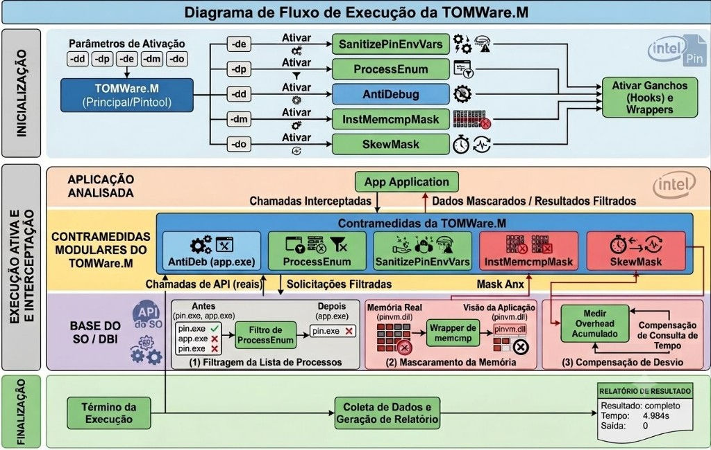
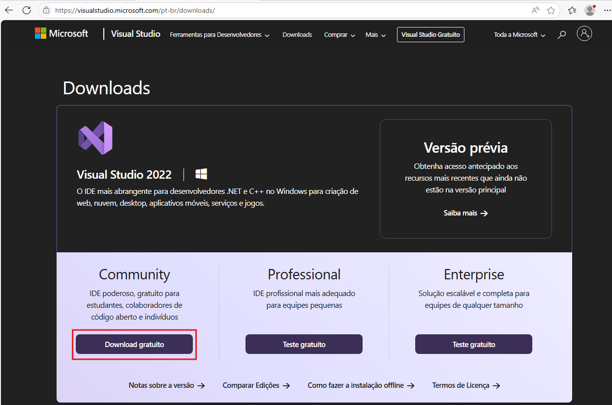
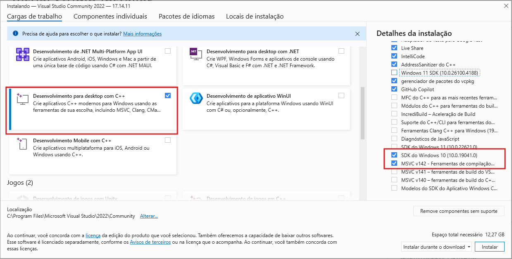
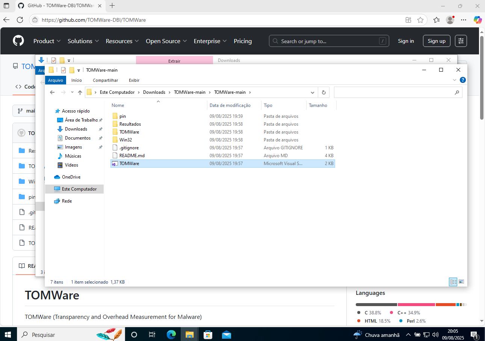
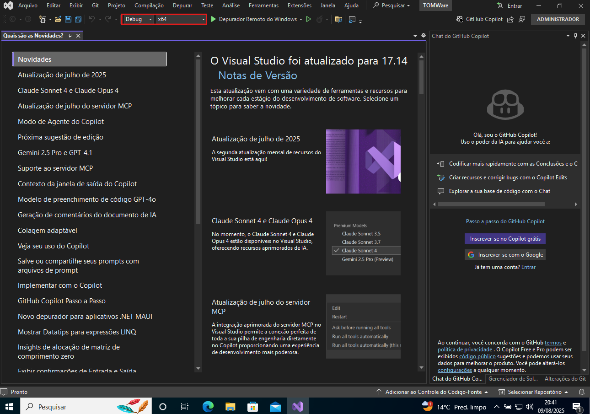
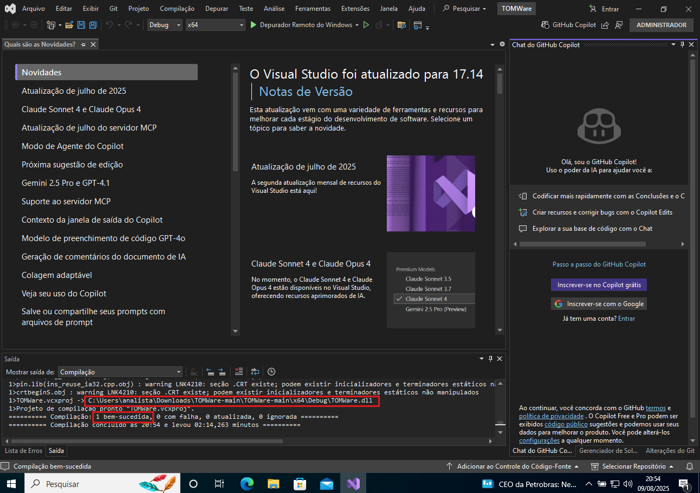
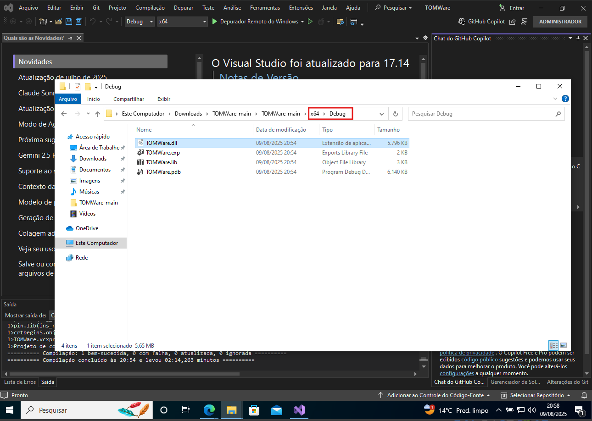

# **TOMWare.M — Mitigating Anti-Instrumentation Techniques in DBI Environments**

**TOMWare.M** (*Transparency and Overhead Measurement for Malware*) is a modular Dynamic Binary Instrumentation (DBI) tool built on **Intel Pin**, aimed at mitigating anti-instrumentation techniques in Windows x64 executables.

Repository: [https://github.com/TOMWare-analises/TOMWare](https://github.com/TOMWare-analises/TOMWare)

This tree is the pintool **and** the measured evidence. Folder map: [§1.3](#13-repository-layout). The nested `TOMWare/` directory is the Visual Studio pintool project, not a second clone. The tool was presented at the SBSeg 2026 Tools Fair. Tables under `experiment/results/` cover two campaigns (JCVHT 31-PE / 10 s and Access 100-PE / 9 000-run). Do not mix those cells.

---

## Reproduce

One git tree; **two binaries**. Published numbers were measured with the **campaign DLL**. That file is **not** in git (`x64/` is gitignored; there is no GitHub Release). Identity is the SHA-256, not a git hash. Catalog: `experiment/environment/build_manifest.json` and `experiment/results/oracles/build_id.json`.

| Artifact | SHA-256 prefix | Role |
|----------|----------------|------|
| Pin 3.28.98749 `pin/pin.exe` | `920A730A…B819` | Same for both binaries |
| Campaign `TOMWare.dll` | `4BBC6270…F0E6` | Table 6 N=30, N=10 oracles, 31-PE corpus, 9 000-run campaign |
| `EmptyPinTool.dll` | `804BE19B…53C8` | `EMPTY` / `pin_empty` ladder |
| Memcmp-fix `TOMWare.dll` | `D55EC952…C143` | `_memicmp_l` four-argument hook only. Source: `main` (`242f800`). `SkewMask.cpp` unchanged |

Candidate **source** for `4BBC6270` (not bit-reproducible): git tag `jcvht-dll-4bbc6270-candidate` = `a22e01d`. Do **not** cite git `3040df7`, `main`, or `242f800` as the campaign DLL. Do not rebuild only to tag.

To check published numbers, copy the campaign DLL onto `x64\Release\TOMWare.dll` from guest snapshot `tomware_go` or from Drive `TOMWare.7z`. Rebuilding from `main` is a **different** SHA-256.

Do not change `SkewMask.cpp`. Do not replace the N=30 table. Do not execute `samples/infected/` on a networked host.

All measured tables are under **`experiment/results/`**. Two campaigns; **do not mix cells**:

| Folder under `experiment/results/` | What | Window / N | DLL |
|--------|------|------------|-----|
| `corpus/` | 17 benign + 14 infected pack (PDFs/CSV) | 10 s (Table 9 protocol) | `4BBC6270` |
| `oracles/` | N=30 timing, N=10 waits/memcmp/`-da`, identify, counters, `manuscript_values.json` | matched oracles | `4BBC6270` |
| `oracles/ctrl_progress/` | `TestRecoverWork` triad + five Table-9 x64 Native/TMW0 recaptures | 30 s / 10 s | `4BBC6270` |
| `campaign/corpus_aligned_10k/` | 100 PE (50+50) × 9 conditions × 10 = 9 000 processed tables | 120 s short / 60 s persistent | `4BBC6270` |

`oracles/collector/` is a **synthetic** 10 s PowerShell+PING smoke. It is not Table 9. Current JCVHT compile: `experiment/validation/manuscript/jcvht_revision/TOMWare_M_c05a1271_CURRENT.pdf`.

**Smoke (no malware), after the campaign DLL is in place:**  
`pin\pin.exe -t x64\Release\TOMWare.dll -q -- Resultados\Apps-Teste\TestOverhead.exe`

**Re-run oracles (guest `tomware_go`, no malware):**  
`powershell -ExecutionPolicy Bypass -File experiment\validation\scripts\Run-Oracles.ps1 -Part All -WaitN 10 -CampaignId n10 -DoTimeoutSec 180`  
If the VM dies: power on without reverting the snapshot; add `-Resume`.

**9 000-run campaign:** `experiment/scripts/host/Run-HostCampaign.ps1` and `experiment/protocol/protocol.md`. Do not overwrite `experiment/results/campaign/` unless you accept a new campaign id.

**Limitations that still stand** (do not mark resolved):

- `SleepEx(..., alertable)` under `-do` can hang until the collector timeout (180 s). Cause not confirmed. `SkewMask.cpp` not changed.
- Campaign DLL: `_memicmp_l` was hooked as three-argument; that oracle `ACCESS_FAULT`s. Fixed on `main` / `D55EC952` only.
- Identify: 31/31 `identified=false`. IAT/string hits are leads, not executed-branch case studies.
- Resource cuts of about −87% peak working set / −38.5% CPU on cited persistent cells are **not** performance gains: those hashes complete with modules off and hit the observation timeout under `-do`.

---

## Abstract

TOMWare.M implements five selectively activatable countermeasures (`-dd`, `-dp`, `-de`, `-dm`, `-do`) on Intel Pin for Windows x64. Controlled test applications show that each module reduces the matching instrumentation indicator; temporal impact depends on the intercepted mechanism. The pintool is an experimental platform for the relationship between **transparency** and **temporal impact** in DBI environments. Published campaign tables are under `experiment/results/` (see **Reproduce**).

---

## Table of Contents

* [Reproduce](#reproduce)
* [1. Structure of this README](#1-structure-of-this-readme)
  * [1.1 Where to look](#11-where-to-look)
  * [1.2 Distributed artifacts](#12-distributed-artifacts)
  * [1.3 Repository layout](#13-repository-layout)
  * [1.4 Demonstration videos (playlist)](#14-demonstration-videos-playlist)
* [2. Artifact badges considered](#2-artifact-badges-considered)
* [3. Basic information](#3-basic-information)
  * [3.1 Introduction to execution and experiments](#31-introduction-to-execution-and-experiments)
  * [3.2 Main features](#32-main-features)
  * [3.3 Architecture](#33-architecture)
  * [3.4 How execution is structured](#34-how-execution-is-structured)
  * [3.5 Recommended environment](#35-recommended-environment)
* [4. Dependencies](#4-dependencies)
* [5. Security](#5-security)
* [6. Installation](#6-installation)
* [7. Minimal test](#7-minimal-test)
* [8. Experiments](#8-experiments)
  * [8.6 Published result evidence](#86-published-result-evidence)
  * [8.7 Experimental infrastructure](#87-experimental-infrastructure)
* [9. License](#9-license)

---

# 1. Structure of this README

## 1.1 Where to look

| Need | Place |
|------|--------|
| Campaign DLL identity, smoke command, what not to mix | **Reproduce** (top) |
| Which folder is the tool vs the tables vs the VM helpers | [§1.3](#13-repository-layout) |
| Knobs `-dd/-dp/-de/-dm/-do` | [§3.2](#32-main-features) |
| Install / build | [§6](#6-installation) |
| Minimal test (no malware) | [§7](#7-minimal-test) |
| Published tables | [§8.6](#86-published-result-evidence) |
| Campaign runner / older `scripts/r2-*` | [§8.7](#87-experimental-infrastructure) and [`experiment/README.md`](experiment/README.md) |
| Current JCVHT article PDF | `experiment/validation/manuscript/jcvht_revision/` |

## 1.2 Distributed artifacts

* Source code of the **TOMWare** pintool (`TOMWare/`).
* Pre-built test binaries (`Resultados/Apps-Teste/`), including `Loop_X_1000/` variants.
* Sources of the test applications (`Resultados/Apps-Teste-src/`).
* Intel Pin 3.28 MSVC x64 (`pin/`), when included in the distribution.
* Signatures for memory masking (`config/signatures.txt`).
* Execution and benchmark scripts (`scripts/`).
* Current execution-flow diagram (`imgs/tomware-fluxo-execucao-23072026.png`).
* Measured tables under `experiment/results/` (31-PE corpus, oracles, 9 000-run campaign) — see **Reproduce** and §8.6.
* Compiled pintools (`x64/Release/*.dll`) are **gitignored**. Copy the campaign `4BBC6270` DLL from snapshot `tomware_go` or Drive `TOMWare.7z`; see **Reproduce**.
* Installer package (Git, Visual Studio, 7-Zip, VMware, Pin, TOMWare, ISO) on [Google Drive — Installers](https://drive.google.com/drive/folders/18bq-fFzjVcBa1-KuJIoL5KAmS_AHkAtB?usp=sharing) — see §4.4.
* Corpus of **benign** and **infected** samples in `samples/` in this repository — see §4.5.
  (Google Drive blocks public sharing of these files by policy; therefore the corpus is shipped via Git.)
* Video playlist (download → installation → configuration → execution → results) in the Drive folder **`demonstracao`** — see §1.4.

> The goal of the artifacts is to enable: (1) exploring the code; (2) verifying functionality (minimal test); (3) reproducing the paper experiments (test apps + real samples under Pin); (4) assessing the temporal impact of the countermeasures.

## 1.3 Repository layout

Paths below are **fixed**. `TOMWare.sln` includes `TOMWare\TOMWare.vcxproj`; guest scripts and Pin commands use `C:\TOMWare\scripts`, `Resultados\Apps-Teste`, and `x64\Release\TOMWare.dll`. Do not rename these folders.

The nested `TOMWare/TOMWare` is not a duplicated clone: the outer folder is the git root (this README + `.sln` + Pin + experiments); the inner folder is the pintool C++ project.

| Path | What it is | Canonical for |
|------|------------|----------------|
| `TOMWare/` | Pintool sources (`AntiDebugMask.cpp`, …) | Building / reading the tool |
| `EmptyPinTool/` | No-op pintool | `EMPTY` / `pin_empty` ladder |
| `FidelityProbe/` | BBL / image / API counters | Fidelity probe |
| `pin/` | Intel Pin 3.28 MSVC x64 | Runtime |
| `x64/Release/` | Compiled DLLs (**gitignored**) | Copy campaign `4BBC6270` here |
| `config/` | `signatures.txt`, mappings | `-sf` |
| `Resultados/Apps-Teste/` | Pre-built oracles, including `TestRecoverWork.exe` | Smoke / §7 |
| `Resultados/Apps-Teste-src/` | Oracle sources | Rebuild test apps |
| `Resultados/benchmarks/` | Local VM dumps | **Not** published tables |
| `scripts/` | Original guest helpers (`run-sample`, `r2-*`) | One-off VM runs; older path |
| `experiment/scripts/` | Planner / host campaign runner / validators | 9 000-run campaign |
| `experiment/validation/scripts/` | `Run-Oracles.ps1`, `Run-CtrlProgress.ps1` | N=10 oracles; CTRL/PROG |
| `experiment/results/` | **Only** place for measured tables | Paper / README numbers |
| `experiment/validation/manuscript/jcvht_revision/` | Current JCVHT PDF + English `.tex` | Article compile |
| `samples/` | Corpus hashes | Copy to VM `malwares/` (§4.5) |
| `imgs/` | README figures | Docs |

What looks repeated but is **not** the same data:

| You see | Do not confuse with |
|---------|---------------------|
| `scripts/` vs `experiment/scripts/` vs `experiment/validation/scripts/` | Guest helpers vs 9 000-run host runner vs oracle/CTRL re-runs |
| `Resultados/` vs `experiment/results/` | Test apps + local dumps vs **published** CSVs/PDFs |
| `samples/` vs `experiment/corpus/corpus.csv` | Files on disk vs the **100-PE Access** catalog (the 31-PE JCVHT pack is the other cut) |
| `oracles/collector/` vs Table 9 / Tabela 12 | Synthetic 10 s PING smoke vs corpus / five-benign recaptures |
| Campaign DLL `4BBC6270` vs `main` / `D55EC952` | Measured tables vs `_memicmp_l` four-arg rebuild |

```text
TOMWare/                                 git root (this README, TOMWare.sln)
├── TOMWare/                             pintool C++ (TOMWare.vcxproj)
├── EmptyPinTool/   FidelityProbe/
├── pin/                                 Intel Pin 3.28
├── x64/Release/                         DLLs, gitignored; copy 4BBC6270
├── config/signatures.txt
├── scripts/                             guest helpers (r2-*, run-sample)
├── experiment/
│   ├── README.md                        campaign infrastructure
│   ├── protocol/ corpus/ config/
│   ├── scripts/                         9 000-run planner/runner
│   ├── validation/
│   │   ├── scripts/                     Run-Oracles.ps1, Run-CtrlProgress.ps1
│   │   └── manuscript/jcvht_revision/   CURRENT.pdf + REVISION.tex
│   └── results/                         published tables only
│       ├── corpus/                      17+14 / 10 s
│       ├── oracles/                     N=30, N=10, identify, build_id.json
│       │   └── ctrl_progress/           TestRecoverWork + five x64 recaptures
│       └── campaign/corpus_aligned_10k/ 100 PE × 9 × 10
├── Resultados/Apps-Teste/               Test*.exe, TestRecoverWork.exe
├── samples/benign|infected
├── imgs/
├── .env.example                         never commit .env
└── LICENSE
```

> When downloading the GitHub `.zip`, the folder may be named `TOMWare-main`. On the VM this tree is `C:\TOMWare`. Copy `samples/` into `malwares\benign\` and `malwares\infected\` (§4.5).

## 1.4 Demonstration videos (playlist)

Screencasts with **burned-in subtitles** (PT-BR). The playlist is a **flow demonstration** (download → installation → configuration → sample run → collection), aligned with this README — it does **not** cover every experiment in §8.

Drive folder: **`demonstracao`** (next to the [installer package](https://drive.google.com/drive/folders/18bq-fFzjVcBa1-KuJIoL5KAmS_AHkAtB?usp=sharing)).

### Watch order

| # | Phase | What the video shows | File | README |
|---|-------|----------------------|------|--------|
| 01 | Download | Git for Windows | `01-download-git.mp4` (+ `.srt`) | §4.4 |
| 02 | Download | Visual Studio Community | `02-download-visual-studio.mp4` (+ `.srt`) | §4.2 / §4.4 |
| 03 | Download | 7-Zip | `03-download-7zip.mp4` (+ `.srt`) | §4.3 / §4.4 |
| 04 | Download | VMware Workstation | `04-download-vmware.mp4` (+ `.srt`) | §3.5 / §4.4 |
| 05 | Download | Windows 10/11 **x64** ISO | `05-download-windows-iso-x64.mp4` (+ `.srt`) | §3.5 / §4.4 |
| 06 | Installation | Install Git | `06-instalacao-git.mp4` | §6.1.1 |
| 07 | Installation | Install Visual Studio (C++ + **v142**) | `07-instalacao-visual-studio.mp4` | §6.1.2 |
| 08 | Installation | Install 7-Zip | `08-instalacao-7zip.mp4` | §4.3 |
| 09 | Installation | Install VMware + create Windows VM | `09-instalacao-vmware-e-criacao-vm.mp4` | §3.5 / §8.1 |
| 10 | Configuration | VM network disabled (before samples) | `10-config-vm-rede-desligada.mp4` | §5.2 / §8.1 |
| 11 | Configuration | Copy `pin.7z` + `TOMWare.7z` (Drive → host → VM) | `11-config-copia-pin-tomware-para-vm.mp4` | §4.1 / §8.1 |
| 12 | Execution | Example: **benign** sample + **`-dm`** countermeasure | `12-execucao-amostra-benigna-dm.mp4` | §5 / §8.1–§8.2 |
| 13 | Results | Collect CSV/JSON under `Resultados\benchmarks\` (+ copy to host) | `13-coleta-resultados-benchmark.mp4` | §8.2–§8.3 |

Naming convention: `NN-phase-topic.mp4` (lexicographic order = watch order). Items **01–05** may ship a sidecar `.srt`; **06–13** have burned-in subtitles.

---

# 2. Artifact badges considered

Badges from the SBSeg **Artifact Technical Committee (CTA)** ([official guidance](https://doc-artefatos.github.io/sbseg2026/)). This artifact **competes for all four**:

| Badge | Criterion (CTA summary) | How this repository addresses it |
|-------|-------------------------|----------------------------------|
| **Available (SeloD)** | Code/data in a stable repository with a minimal README | Public GitHub; this README; corpus in `samples/`; [Installers](https://drive.google.com/drive/folders/18bq-fFzjVcBa1-KuJIoL5KAmS_AHkAtB?usp=sharing) and playlist on Drive; evidence under `experiment/results/` |
| **Functional (SeloF)** | Runnable artifact; deps, environment, install, and minimal example | §3.5 / §4 (deps and versions), §6 (install), §7 (minimal test with apps in `Resultados/Apps-Teste/`) |
| **Sustainable (SeloS)** | Modular, readable code mapped to paper claims | `TOMWare/` + `scripts/` layout; knobs `-dd/-dp/-de/-dm/-do`; diagram §3.3; published tables under `experiment/results/` |
| **Reproducible (SeloR)** | Reproduce the main paper claims | **Reproduce** above (campaign DLL `4BBC6270`, tag `jcvht-dll-4bbc6270-candidate`); §8; playlist §1.4 as a flow demo |

Base work: SBSeg 2025 (TOMWare). Tool extension (**TOMWare.M**, SBSeg 2026 Tools Fair): **AntiDebug** (`-dd`) and **ProcessEnum** (`-dp`). Measured evidence in this repository also covers the JCVHT 31-PE pack and the 100-PE / 9 000-run campaign (same campaign DLL; do not mix cells).

---

# 3. Basic information

## 3.1 Introduction to execution and experiments

Context-aware malware can detect Intel Pin via: debugging indicators, process enumeration (`pin.exe`), `PIN_*` environment variables, in-memory signatures, and timing discrepancies (overhead). TOMWare.M masks these surfaces to enable more transparent dynamic analysis.

Experiments in this repository have two goals:

1. **Validate functionality** — show that each module reduces the corresponding indicator on the test application (controlled oracle).
2. **Assess impact** — record wall-clock execution times under Pin **without** and **with** the countermeasure (`Result` field), including on real samples.

> **Isolated environment:** malware experiments must run **only in a VM**, restored from a clean snapshot after each sample.

> **Benign binaries:** test apps and legitimate tools may run on the host, without disabling antivirus, to validate the installation.

## 3.2 Main features

The architecture distinguishes **modules** (wrappers activated by command-line parameters) from **countermeasures** (mechanisms that mask a detection surface). The names are **distinct**: the module is the wrapper; the countermeasure is the mechanism it triggers.

```text
Parameters (-da -dd -de -dm -do -dp)
        │
        ▼
 Instrumentation ──► Modules (wrappers) ──► Countermeasures
                           AntiDeb                    AntiDebug
                           ProcessE                   ProcessEnum
                           SanitizePin                SanitizePinEnvVars
                           InstMem                    InstMemcmpMask
                           SkewM                      SkewMask
```

| Parameter | Module (wrapper) | Countermeasure triggered | Mechanism (implementation) |
|-----------|------------------|--------------------------|----------------------------|
| `-dd` | **AntiDeb** | **AntiDebug** | PEB: `BeingDebugged`, `NtGlobalFlag` (`AntiDebugMask.cpp`) |
| `-dp` | **ProcessE** | **ProcessEnum** | Filter on `Process32*` / `Module32*` / `GetModuleHandle*` |
| `-de` | **SanitizePin** | **SanitizePinEnvVars** | Sanitize the PEB environment block (`PIN_*`) |
| `-dm` | **InstMem** | **InstMemcmpMask** | `memcmp*` wrappers + **Signatures** (`-sf`). On `main`, `_memicmp_l` is four-argument; the campaign DLL still uses the three-argument hook |
| `-do` | **SkewM** | **SkewMask** | Timing hooks + **Calibrate Mask** (Sleep/QPC…) |
| `-da` | *(all modules)* | all five countermeasures | Equivalent to `-de -dm -do -dd -dp` (**does not** include `-go`) |

**Auxiliary knobs**

| Knob | Description |
|------|-------------|
| `-sf PATH` | Extra signatures for **InstMem** / **InstMemcmpMask** (default: `config/signatures.txt`) |
| `-q` | Quiet mode (suppresses informational logs) |
| `-me N` | Exception limit before abort (`0` = unlimited) |
| `-go` | **Artificial** overhead — demos with `TestOverhead.exe` only (outside `-da`) |
| `-gdb` | Simulate PEB debug indicators — baseline demo for **AntiDeb** |

> **Modules** are complementary and selectively activatable via **parameters**, without rebuilding. Current support: **native 64-bit PE** (and x86 builds depending on configuration); no direct support for .NET/Java/scripts.

## 3.3 Architecture

<p align="center">
  
</p>

**Reading the diagram (execution flow)**

The figure organizes the pintool lifecycle into three phases, aligned with `TOMWare.cpp` / `Instrumentation.cpp` and the countermeasure sources:

1. **Initialization** — `PIN_Init` + `InitInstrumentation()` reads the **parameters** (`-dd`, `-dp`, `-de`, `-dm`, `-do`; `-da` enables all) and wires the matching **modules/countermeasures**; then **activates hooks and wrappers** (`IMG_AddInstrumentFunction`, RTN replace, image callbacks).
2. **Active execution and interception** — the **analyzed application** makes calls; the central band of **modular countermeasures** returns masked/filtered data; underneath, the OS/DBI layer implements, among others:
   - **(1) Process-list filtering** — **ProcessEnum** hides `pin.exe` / Pin artifacts in `Process32*` / `Module32*` / `GetModuleHandle*`.
   - **(2) Memory masking** — **InstMemcmpMask** (`memcmp*` wrappers + **Signatures** `-sf`) avoids hits on Pin strings/modules.
   - **(3) Skew compensation** — **SkewMask** measures accumulated overhead and compensates timing queries (Sleep/QPC…).
   - In parallel (not detailed in panels 1–3, but active when enabled): **AntiDebug** and **SanitizePinEnvVars** act mainly on the **PEB** (`BeingDebugged` / `NtGlobalFlag`; `PIN_*` variables).
3. **Finalization** — end of the Pin run; **data collection and reporting** (`Result`: outcome, time, output) come from the **evaluation harness** (`scripts/run-baseline-dm-one.ps1` and related), not from a generator embedded in the DLL.

| Parameter | Countermeasure in the flow | Implementation |
|-----------|----------------------------|----------------|
| `-de` | SanitizePinEnvVars | `SanitizePinEnvVars.cpp` |
| `-dp` | ProcessEnum | `ProcessEnumMask.cpp` |
| `-dd` | AntiDebug | `AntiDebugMask.cpp` |
| `-dm` | InstMemcmpMask | InstMemcmp* + `config/signatures.txt` |
| `-do` | SkewMask | `SkewMask.cpp` (timing calibration) |
| `-da` | all five | equivalent to `-de -dm -do -dd -dp` |

| Component | Role | Location |
|-----------|------|----------|
| **Main / TOMWare.M** | `PIN_Init` → start instrumentation | `TOMWare/TOMWare.cpp` |
| **Instrumentation** | Parse parameters and register hooks | `TOMWare/Instrumentation.cpp` |
| **Countermeasures** | Selective masking per surface | sources above |
| **Test apps** | Functional oracles (console evidence) | `Resultados/Apps-Teste/` |
| **Harness** | Experiment `Result` / CSV / JSON report | `scripts/` |

**Consistency with the code (verified):** parameter→init mapping matches `InitInstrumentation()`; ProcessEnum / InstMemcmpMask / SkewMask match panels (1)–(3); AntiDebug and SanitizePinEnvVars exist and are enabled by `-dd`/`-de`, though the figure emphasizes them more at initialization than in the lower panels. The **Result Report** block corresponds to the benchmark protocol (§3.4 / §8), not to an internal pintool module.

Equivalent Mermaid diagram (flow): `imgs/tomware-architecture-current.mmd`.  
Earlier structural figure (modules → countermeasures): `imgs/tomware_pintool_20072026.png`.  
Annotated variant (PEB / Signatures / Calibrate): `imgs/tomware-architecture-annotated.png`.

## 3.4 How execution is structured

Each experiment run follows **two stages**:

| Stage | Target | Goal |
|-------|--------|------|
| **[1] Test app** | `TestAntiDebug.exe`, `TestProcessEnum.exe`, … | Functional evidence on the console (`Resumo` / alerts box) |
| **[2] Real sample** | `malwares\infected\<SHA256>.exe` | Exercise the sample under Pin ± countermeasure; time in the `Result` field |

Comparison protocol:

1. **Native** (behavioral reference, no Pin).
2. **Pin + TOMWare without the countermeasure** (baseline — indicator appears).
3. **Pin + TOMWare with the countermeasure** (indicator masked).

Recommended script for side-by-side output:

```powershell
.\scripts\run-baseline-dm-one.cmd <SHA256> <de|dm|do|dd|dp|da>
```

> **Note (ProcessEnum / timing):** effectiveness of the **ProcessEnum** countermeasure (**ProcessE** module, `-dp`) is shown by the test-app box (`pin.exe : N → 0`). If the real sample reaches `outcome=timeout`, wall-clock time **must not** be treated as an effectiveness metric for that countermeasure.

## 3.5 Recommended environment

| Layer | Suggested specification |
|-------|-------------------------|
| **Host** | CPU with VT-x/AMD-V; RAM ≥ 16 GB; SSD |
| **Hypervisor** | VMware Workstation / VirtualBox 7.x |
| **VM (guest)** | Windows 10/11 x64; ≥ 4 vCPU; 6–8 GB RAM; Host-only or disconnected network during malware |
| **Snapshot** | Restore a clean snapshot **after each sample** |

> To validate the install only, use the minimal test (§7) on the host with the test apps — **no** malware.

---

# 4. Dependencies

## 4.1 Runtime

* **Intel Pin** 3.28 (x64, MSVC): [official download](https://software.intel.com/sites/landingpage/pintool/downloads/pin-3.28-98749-g6643ecee5-msvc-windows.zip) — repository `pin/` folder (when provided) or a local install.
* **TOMWare.dll** — not in git. For published numbers, copy the campaign binary (`4BBC6270…F0E6`) to `x64\Release\TOMWare.dll`. Building from `main` produces a different SHA-256 (see **Reproduce**).

## 4.2 Build (Windows host)

| Tool | Version / note |
|------|----------------|
| Visual Studio 2019 or 2022 | *Desktop development with C++* workload |
| Toolset | **v142** (required, including on VS 2022) |
| Windows 10 SDK | ≥ 10.0.19041 |
| Intel Pin | 3.28 x64 **MSVC** (not Clang) |

## 4.3 VM

| Tool | Use |
|------|-----|
| VMware / VirtualBox | Isolation and snapshots |
| 7-Zip (optional) | Extract password-protected samples |

## 4.4 Installer package (Google Drive)

To ease reproduction, environment installers are collected in the shared folder:

**[TOMWare Installers (Google Drive)](https://drive.google.com/drive/folders/18bq-fFzjVcBa1-KuJIoL5KAmS_AHkAtB?usp=sharing)**

Drive is a **mirror** of the official sites (Git, Microsoft, 7-Zip, Broadcom/VMware, Intel Pin). Prefer official pages when possible; use Drive to set up the environment faster.

### Contents of the `Instaladores` folder

| # | Drive file | What it is | Where to use | Note |
|---|------------|------------|--------------|------|
| 1 | `7z2602-x64.exe` | 7-Zip (x64) | **Host** and **VM** | Extracts `.7z` / `.zip` (`pin.7z`, `TOMWare.7z`, samples) |
| 2 | `Git-*-64-bit.exe` | Git for Windows | **Host** (and VM if cloning) | Needed for `git clone` of the repository |
| 3 | `VisualStudioSetup.exe` | Visual Studio Installer | **Host** (build) | C++ workload + **v142** toolset (§4.2 / §6.1) |
| 4 | `VMware-Workstation-Full-*.exe` | VMware Workstation | **Host** | Hypervisor for the experiment VM (§3.5) |
| 5 | `Windows.iso` | Windows **x64** ISO | **Host** → create VM | **Use this** for Pin/TOMWare.M (Intel/AMD) |
| 6 | `MediaCreationTool_22H2.exe` | Media Creation Tool (Win 10 22H2) | **Host** (optional) | Official alternative to download/generate an x64 ISO |
| 7 | `Win11_25H2_*_Arm64.iso` | Windows 11 **Arm64** ISO | — | **Do not use** with Pin 3.28 MSVC x64 / TOMWare.M |
| 8 | `pin.7z` | Intel Pin 3.28 (MSVC x64) | Extract on the VM (or host) under `C:\TOMWare\pin\` | Must contain `pin.exe`, `intel64\`, etc. |
| 9 | `TOMWare.7z` | TOMWare code / artifact | Extract on the VM under `C:\TOMWare\` | Includes scripts, `TOMWare.dll` (if pre-built), test apps |
| 10 | `TOMware_pin_samples_benign.7z` | (Optional) packed benign set | Extract on the VM under `malwares\benign\` | Prefer `samples/benign/` from the repository (§4.5) |

> **Arm64:** the `Win11_*_Arm64.iso` is only for ARM machines. For the experiments in this README, the VM must be **Windows 10/11 x64**. Use `Windows.iso` (or an x64 ISO from the Media Creation Tool).

### Correct installation sequence

Order aligned with the playlist (§1.4) and the host → VM flow:

| Step | Where | Action | File(s) |
|-----:|-------|--------|---------|
| 1 | Host | Install **7-Zip** | `7z2602-x64.exe` |
| 2 | Host | Install **Git** | `Git-*-64-bit.exe` |
| 3 | Host | Install **Visual Studio** (C++ + **v142**) | `VisualStudioSetup.exe` |
| 4 | Host | Install **VMware Workstation** | `VMware-Workstation-Full-*.exe` |
| 5 | Host | Create VM with **x64** ISO (not Arm64) | `Windows.iso` (or MCT → x64 ISO) |
| 6 | VM | (Optional) install 7-Zip / Git in the guest | same `.exe` files |
| 7 | VM | Extract **Pin** under `C:\TOMWare\pin\` | `pin.7z` |
| 8 | VM | Extract **TOMWare** under `C:\TOMWare\` | `TOMWare.7z` |
| 9 | VM | Prepare samples | Copy/extract from `samples/` → `malwares\benign\` and `malwares\infected\` (§4.5) |
| 10 | VM | Before running samples: network / Internet / AV / firewall **disabled** | — (§5 / §8.1) |

Pintool build (if `x64\Release\TOMWare.dll` is not already in the package): §6.1 on the **host** or on a VM with VS installed.

Videos: download/install of items 1–5 → playlist §1.4 (01–09); copy Pin/TOMWare → item **11**; benign run → **12**; collection → **13**.

## 4.5 Experiment samples (`samples/`)

Samples used in the tests (**benign** and **infected**) are distributed **in the repository**, under:

```text
samples/
├── benign/      ← <SHA256>.exe
└── infected/    ← <SHA256>.zip  (+ password.txt)
```

> **Why not Google Drive?** Public sharing of files classified as malware on Drive violates the platform policy and gets blocked. Therefore the corpus is versioned under `samples/` (academic use / Tools Fair).

| Repo folder | Destination on the VM | Format | Use |
|-------------|----------------------|--------|-----|
| `samples/benign/` | `C:\TOMWare\malwares\benign\<SHA256>.exe` | `.exe` | Benign corpus (`-SampleType benign`) |
| `samples/infected/` | `C:\TOMWare\malwares\infected\<SHA256>.exe` | `.zip` → extract `.exe` | Infected corpus (script default) |

**Infected samples:** ZIPs are password-protected. The password is in `samples/infected/password.txt` (value: `infected`). Extract with 7-Zip and keep/rename the executable as `<SHA256>.exe` at the destination.

Example (on the VM, after cloning/copying the repo to `C:\TOMWare`):

```powershell
New-Item -ItemType Directory -Force -Path C:\TOMWare\malwares\benign, C:\TOMWare\malwares\infected | Out-Null
Copy-Item C:\TOMWare\samples\benign\*.exe C:\TOMWare\malwares\benign\ -Force
# Extract each ZIP under samples\infected\ with password "infected" into malwares\infected\
# (7-Zip GUI or: 7z x -pinfected file.zip -oC:\TOMWare\malwares\infected\)
```

> **Security:** prepare and run infected samples **only in the VM**, with network/AV/firewall disabled (§5). Do not run them on the host.

---

# 5. Security

TOMWare.M **does not contain malicious code** — it is a C/C++ pintool that masks Pin traces. **Risk comes from the real samples** used in the experiments.

## 5.1 Risk vectors

| Vector | Description |
|--------|-------------|
| Sample execution | VM escape may infect the host |
| Network | Payload download / exfiltration |
| Shared folders / clipboard | Escape channel to the host |

## 5.2 Mandatory measures

1. Do not run real samples on the host.
2. Dedicated VM; network disabled or Host-only during execution.
3. Clean snapshot; restore after each sample.
4. Disable shared folders/clipboard while malware runs; enable them only to copy logs **before** restoring.
5. Test apps under `Resultados/Apps-Teste/` are benign and may run on the host.

## 5.3 Legal notice

Samples and instructions are intended for **academic purposes**. The authors are not liable for damage from misuse or use outside a controlled environment.

---

# 6. Installation

## 6.1 Build (optional — a new SHA-256, not the campaign DLL)

A `git clone` does **not** contain `x64\Release\TOMWare.dll`. Copy the campaign binary first if the goal is to check published numbers (**Reproduce**). Build from `main` only when you accept a different hash (`SkewMask.cpp` must stay unchanged; a rebuild still invalidates Table 6).

### 6.1.1 Get the code

```powershell
git clone https://github.com/TOMWare-analises/TOMWare.git
cd TOMWare
```

### 6.1.2 Dependencies

1. Visual Studio with toolset **v142**.
2. Windows SDK ≥ 10.0.19041.
3. Pin 3.28 MSVC extracted under `pin\` (direct contents: `pin.exe`, `intel64\`, etc.).

Installers (Git, VS, 7-Zip, VMware, Pin, TOMWare) are also on [Google Drive TOMWare](https://drive.google.com/drive/folders/18bq-fFzjVcBa1-KuJIoL5KAmS_AHkAtB?usp=sharing) — see §4.4.

### 6.1.3 Build

1. Open `TOMWare.sln`.
2. If VS offers a toolset upgrade → **No** (keep v142).
3. Configuration **`Release | x64`**.
4. Build (**Ctrl+Shift+B**).

Expected output:

```text
x64\Release\TOMWare.dll
```

That file will **not** hash to `4BBC6270`. Do not overwrite the campaign copy on the guest. The `_memicmp_l` four-argument fix lives on `main` (`242f800`); the focused-test binary that passed those oracles hashed to `D55EC952`.

<details>
<summary>Screenshots — building with VS 2022</summary>

<p align="center"></p>
<p align="center"></p>
<p align="center"></p>
<p align="center"></p>
<p align="center"></p>
<p align="center"></p>

</details>

**MSBuild (command line):**

```powershell
& "${env:ProgramFiles}\Microsoft Visual Studio\2022\Community\MSBuild\Current\Bin\MSBuild.exe" `
    TOMWare.sln /p:Configuration=Release /p:Platform=x64
```

## 6.2 Execution

### 6.2.1 Basic syntax

```powershell
.\pin\pin.exe -t .\x64\Release\TOMWare.dll [KNOBS] -- <target.exe>
```

Examples:

```powershell
# AntiDebug
.\pin\pin.exe -t .\x64\Release\TOMWare.dll -dd -q -- .\Resultados\Apps-Teste\TestAntiDebug.exe

# ProcessEnum
.\pin\pin.exe -t .\x64\Release\TOMWare.dll -dp -q -- .\Resultados\Apps-Teste\TestProcessEnum.exe

# All countermeasures + follow child (real sample)
.\scripts\run-sample.ps1 -Sample C:\TOMWare\malwares\infected\<SHA256>.exe -DefendAll -Quiet -FollowChild
```

---

# 7. Minimal test

Validates the installation **without malware**, using test apps on the host.

## 7.1 Prerequisites

* Windows 10/11 x64
* `pin\` and `x64\Release\TOMWare.dll`
* `Resultados\Apps-Teste\TestGetEnvironments.exe` (or another app from the table)

## 7.2 Step by step

```powershell
cd C:\path\to\TOMWare

# (1) Without Pin — reference
.\Resultados\Apps-Teste\TestGetEnvironments.exe

# (2) Pin without countermeasure — should alert / detect traces
.\pin\pin.exe -t .\x64\Release\TOMWare.dll -q -- .\Resultados\Apps-Teste\TestGetEnvironments.exe

# (3) Pin with countermeasure — indicator masked
.\pin\pin.exe -t .\x64\Release\TOMWare.dll -de -q -- .\Resultados\Apps-Teste\TestGetEnvironments.exe
```

| Test app | Knob |
|----------|------|
| `TestGetEnvironments.exe` | `-de` |
| `TestMemoryScan.exe` | `-dm` |
| `TestOverhead.exe` | `-do` (+ `-go` in demos) |
| `TestAntiDebug.exe` | `-dd` |
| `TestProcessEnum.exe` | `-dp` |

Via wrapper:

```powershell
.\scripts\run-sample.ps1 -Sample .\Resultados\Apps-Teste\TestProcessEnum.exe -ProcessEnumDefend -Quiet
.\scripts\run-sample.ps1 -Sample .\Resultados\Apps-Teste\TestAntiDebug.exe -DebugDefend -Quiet
```

---

# 8. Experiments

## 8.1 Prepare the VM

1. Create a Windows 10/11 x64 VM (clean snapshot).
2. Copy the repository (or artifacts) to `C:\TOMWare`.
3. Copy the campaign `4BBC6270` DLL to `x64\Release\TOMWare.dll` (or build from `main` only if you accept a new hash — **Reproduce**).
4. Prepare samples from `samples/` (§4.5):
   - `C:\TOMWare\malwares\benign\<SHA256>.exe`
   - `C:\TOMWare\malwares\infected\<SHA256>.exe` (extract the `.zip` files with the password in `samples/infected/password.txt`)
5. Disable network / Host-only; disable AV and firewall if the paper protocol requires it.

Video demo: §1.4 items **10–12** (network off → copy Pin/TOMWare → benign `-dm` run).

## 8.2 Reproduce baseline vs countermeasure comparison

```powershell
# Prefer a single line (avoid "^" in CMD — avoids the "More?" prompt)
powershell.exe -NoProfile -ExecutionPolicy Bypass -File "C:\TOMWare\scripts\run-baseline-dm-one.ps1" `
  -Sha256 "36685efcf34c7a7a6f6dd2e48199e4700b5ab8fe3945a50297703dd8daced74f" `
  -Countermeasure dd

# Other modules
.\scripts\run-baseline-dm-one.cmd a0aeb837 dp
.\scripts\run-baseline-dm-one.cmd 17c79863 dm
.\scripts\run-baseline-dm-one.cmd 36685efc da -Loop1000

# Benign sample: 10 independent runs for each countermeasure
.\scripts\run-baseline-dm-one.ps1 `
  -Sha256 "4D6937E8D7D58CD1D9224A11E48549A08505836EFABD6FED17A67D42466265BB" `
  -SampleType benign -AllCountermeasures
```

The script prints, on the same console:

* sample path (hash);
* Pin command for the test app;
* evidence box (baseline vs `-xx`);
* `Result` line for the real sample.

## 8.3 Corpus / benchmark

```powershell
.\scripts\benchmark-poc.ps1
.\scripts\benchmark-corpus.ps1 -SamplesDir C:\TOMWare\malwares\infected -FollowChild -TimeoutSeconds 120
```

Typical outputs: `Resultados\Avaliacao\`, `Resultados\baseline-<cm>-<hash8>.log`.

With `-Repeat N`, each baseline and countermeasure starts as an independent
process. Order alternates per round to reduce warm-up bias.
Detailed reports are written to:

* `Resultados\benchmarks\benchmark-<type>-<cm>-<hash8>-<date>.csv` — one row per run,
  including status, response, and a functional-evidence summary;
* `Resultados\benchmarks\benchmark-<type>-<cm>-<hash8>-<date>.json` — runs, full
  functional evidence, and performance evaluation with mean, median, p95, standard
  deviation, min, max, and outcome counts;
* `Resultados\benchmarks\benchmark-<type>-all-<hash8>-<date>.csv|json` — automatic
  consolidation of all five countermeasures when using `-AllCountermeasures`.

`-AllCountermeasures` runs `de`, `dm`, `do`, `dd`, and `dp` sequentially.
It does not include `da`, because `da` measures all protections enabled at once,
not each countermeasure in isolation.

Each report answers separately:

* **Functional:** “Did the countermeasure hide Pin?” (`PASS`, `FAIL`, or `INCONCLUSIVE`);
* **Performance:** “What was the performance impact?” (`VALID` or `INCONCLUSIVE`).

A functional result may be `PASS` even when performance is inconclusive:
the two conclusions use different evidence.

By default, `scripts/benchmark-*.ps1` uses a 10-second observation window
(`-SampleObservationSeconds 10`). That is the JCVHT 31-PE / Table 9 **protocol**,
not the 9 000-run campaign (120 s short-lived / 60 s persistent in
`experiment/protocol/protocol.md`). `experiment/results/oracles/collector/` is a
synthetic 10 s smoke (PowerShell+PING), not Table 9.

Applications that exit naturally keep outcome `complete`; GUI or persistent
applications are terminated at the end of the window and receive outcome
`observed`. During the window, the benchmark collects accumulated CPU, equivalent
single-core utilization, average/peak working-set memory, and peak private memory
for Pin and the sample. Persistent applications can therefore still get a valid
paired **resource** comparison, even when total wall-time comparison is invalid
because duration was capped.

These metrics represent startup plus the observed state during the window.
They do not measure latency of a specific GUI action; that would require
automating the same action in every run. They also do not prove that a sample
executed a hooked check: identify on the 31-PE pack is 31/31 `identified=false`.

## 8.4 Timing measurement (loop apps)

```powershell
Measure-Command {
  .\pin\pin.exe -t .\x64\Release\TOMWare.dll -dm -q -- `
    .\Resultados\Apps-Teste\Loop_X_1000\TestMemoryScan.exe
}
```

## 8.5 Quick interpretation of results

| Observation | Interpretation |
|-------------|----------------|
| Baseline: alert / count > 0; with knob: `OK` / zeros | Countermeasure is **functional** on the tested surface |
| `Result … outcome=complete` | Sample time may enter quantitative comparison |
| `Result … outcome=timeout` | Sample did not finish within the limit — **do not** use as a valid effectiveness time (common with `-dp`) |

## 8.6 Published result evidence

All published tables live in one place. Two campaigns share the tree; **do not mix cells** (31-PE / 10 s is not the 100-PE / 9 000-run).

```text
experiment/results/
├── corpus/                         17+14 pack (per-hash PDF/CSV + consolidations)
├── oracles/                        N=30 timing, N=10 waits/memcmp/-da, identify,
│                                   counters, manuscript_values.json, build_id.json
│   └── ctrl_progress/              TestRecoverWork triad + five Table-9 x64 recaptures
└── campaign/corpus_aligned_10k/    100 PE × 9 × 10 processed tables
```

| Content | Location |
|---------|----------|
| Campaign DLL / Pin / snapshot | `experiment/results/oracles/build_id.json` (`4BBC6270`, `tomware_go`) |
| Per-sample report (PDF) | `experiment/results/corpus/benign/<SHA256>/` and `…/malign/<SHA256>/` |
| Benign consolidated (17) | `experiment/results/corpus/benign/TOMWare-corpus-benigno-17-amostras.pdf` |
| Infected consolidated (14) | `experiment/results/corpus/malign/TOMWare-corpus-maligno-14-amostras.pdf` |
| Benign × infected | `experiment/results/corpus/comparativo/` |
| Official oracle figures | `experiment/results/oracles/manuscript_values.json` |
| CTRL/PROG recaptures | `experiment/results/oracles/ctrl_progress/` |
| 9 000-run processed tables | `experiment/results/campaign/corpus_aligned_10k/` |
| 100-PE catalog | `experiment/corpus/corpus.csv` |
| JCVHT article compile | `experiment/validation/manuscript/jcvht_revision/TOMWare_M_c05a1271_CURRENT.pdf` |
| Local VM dump (not published) | `Resultados\benchmarks\` |

Samples: `samples/` (§4.5). How to re-run: **Reproduce** at the top of this README.

## 8.7 Experimental infrastructure

`experiment/` is the campaign and oracle runner. `scripts/r2-*.ps1` is the older
path and reuses the VM/snapshot discipline of §8.1. Compiled DLLs are not in git.
Copy `TOMWare.dll`, `EmptyPinTool.dll`, and `FidelityProbe.dll` to the VM from
snapshot `tomware_go` or Drive `TOMWare.7z`. Builds are done on the host, not
inside the guest.

| Protocol | Script / artifact | Purpose |
|----------|-------------------|---------|
| Matched AntiDebug | manual `-gdb -q` vs `-gdb -dd -q` | Paired functional validation (do **not** label AntiDebug as unvalidated) |
| Baseline ladder | `scripts/r2-baseline-ladder.ps1` | Native → `pin_empty` → disabled → enabled → `-da` |
| Empty pintool | `EmptyPinTool/` + `scripts/r2-build-empty-pintool.ps1` | Isolate Pin overhead without TOMWare modules |
| SkewMask fixed-N | `scripts/r2-skewmask-fixedN.ps1` | Frozen N=30, retain **all** runs; do **not** re-run to refresh Table 6 |
| Oracle re-run | `experiment/validation/scripts/Run-Oracles.ps1` | N=10 waits/memcmp/`-da` on guest `tomware_go` |
| CTRL/PROG recapture | `experiment/validation/scripts/Run-CtrlProgress.ps1` | `TestRecoverWork` + five Table-9 x64; not a malware case study |
| Host 9 000-run | `experiment/scripts/host/Run-HostCampaign.ps1` | 100 PE × 9 × 10; do not overwrite published `campaign/` tables |
| Behavioral fidelity | `scripts/r2-behavioral-fidelity.ps1`, `r2-fidelity-one-sample-noshares.ps1` | Zero-share / one-sample-then-exit loops on a snapshot |
| Fidelity probe | `FidelityProbe/` | BBL / image / API-watchlist counters for behavioural comparisons |
| Corpus VT labels | `scripts/r2-corpus-vt-lookup.ps1` + `.env.example` | Hash-only VirusTotal `suggested_threat_label` (API key in `.env`, never committed) |

N=30 SkewMask compensation rates (all runs kept): baseline below-threshold **7/30**,
treatment **30/30**. Large SkewMask resource deltas (about −87% peak working set /
−38.5% CPU on cited persistent cells) are **not** performance gains: confirmatory
Pin runs on the three benign hashes that drive those working-set cuts (`1128D0B4`,
`16B45C2C`, `445E672D`) complete with modules off and hit the observation timeout
under `-do`. Metric validity is stated a priori (profile → primary metric;
ProcessEnum never uses wall-clock as effectiveness; fixed-N attempts; no
outcome-selected exclusions).

Do not cite the superseded first-attempt re-exec fraction from the old 31-PE
timing protocol. `SkewMask.cpp` stays as in the campaign source.

**Matched AntiDebug (knobs):**

```powershell
# Baseline (debugger indicators visible under -gdb)
.\pin\pin.exe -t .\x64\Release\TOMWare.dll -gdb -q -- .\Resultados\Apps-Teste\TestAntiDebug.exe

# Treatment (matched + AntiDebug countermeasure)
.\pin\pin.exe -t .\x64\Release\TOMWare.dll -gdb -dd -q -- .\Resultados\Apps-Teste\TestAntiDebug.exe
```

**SkewMask fixed-N / VT (examples):**

```powershell
.\scripts\r2-skewmask-fixedN.ps1
# Copy .env.example → .env and set VT_API_KEY (gitignored)
.\scripts\r2-corpus-vt-lookup.ps1
```

---

# 9. License

This project is distributed for academic and research purposes. See [`LICENSE`](LICENSE) at the repository root.

**Intel Pin** has its own license (see `pin/licensing/`).

**Suggested citation (TOMWare.M / SBSeg 2026 Tools Fair):**

```text
TOMWare.M: A Tool for Mitigating Anti-Instrumentation Techniques
in DBI Environments — Tools Fair, SBSeg 2026.
https://github.com/TOMWare-analises/TOMWare
```

Software identity for the measured tables: campaign DLL SHA-256 prefix `4BBC6270`;
git tag `jcvht-dll-4bbc6270-candidate`. Do not cite git `3040df7` or `main` as that
binary.

---

## Quick reference

```text
TOMWare.M — Transparency and Overhead Measurement for Malware
Intel Pin 3.28 · Windows x64 · MSVC v142
Knobs: -dd -dp -de -dm -do | -da | -sf -q -go -gdb -me
```
